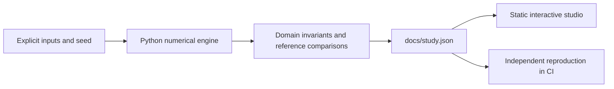

# Market Replay Studio

Queue dynamics, inventory control and adverse selection you can inspect.

**[Open the interactive research studio](https://fyodoramanov1.github.io/market-microstructure-lab/)** · [Measured study](docs/study.json) · [Technical case study](reports/applied-study.md) · [Source](src/studio.py)

Build an auditable event-driven exchange and execution research instrument; realistic accounting comes before attractive P&L.

## What you can do

- **Balanced flow:** Balanced flow: a price/time-priority book, cancellable orders, inventory-constrained quoting and stale quotes. Replay the managed policy, then compare net results across sixteen paired seeds.
- **Directional market:** Directional market: a price/time-priority book, cancellable orders, inventory-constrained quoting and stale quotes. Replay the managed policy, then compare net results across sixteen paired seeds.
- **Informed flow:** Informed flow: a price/time-priority book, cancellable orders, inventory-constrained quoting and stale quotes. Replay the managed policy, then compare net results across sixteen paired seeds.

The interface selects recorded experiments, toggles chart series and exports the comparison table. Each view includes the method, assumptions, provenance and its reproduce command. No API key is required. Market Replay additionally plays the actual book snapshots; the Evidence Observatory performs local retrieval and numeric-claim checks.

## Reproduce

Python 3.12; CPU only. From this repository:

```powershell
python -m pip install -r requirements.txt
python src/studio.py --out docs/study.json
python -m http.server 8000 --directory docs
```

Open `http://localhost:8000`. The static app fetches its local JSON, so use HTTP rather than opening `index.html` directly. No JavaScript build step or package installation is needed.

CI reproduces every applied case with `python src/studio.py --check docs/study.json`, checks numerical invariants and retains the original independent numerical contract. New applied code lives under `src/`; `lab.py` and its original CLI remain compatible for the existing research milestones.

## Recorded findings

### Balanced flow

- Managed net after liquidation: **607.9 ticks**
- Paired improvement vs symmetric: **-497.644 ticks**
- Paired difference standard error: **42.4132 ticks**
- Cash / inventory violations: **0 **

### Directional market

- Managed net after liquidation: **611.9 ticks**
- Paired improvement vs symmetric: **-528.831 ticks**
- Paired difference standard error: **115.803 ticks**
- Cash / inventory violations: **0 **

### Informed flow

- Managed net after liquidation: **367.5 ticks**
- Paired improvement vs symmetric: **-428.706 ticks**
- Paired difference standard error: **41.9002 ticks**
- Cash / inventory violations: **0 **

## Interpretation

The inventory-skew policy reduces exposure but loses net outcome relative to symmetric quotes in these paired scenarios. This is a useful negative result: inventory control carries an opportunity cost, and stale quotes add a separate cost. The simulator does not establish which policy is best on real exchange data.

## Design




## Scientific boundaries

Entirely synthetic event stream. Matching uses the repository’s actual price/time-priority book; no fill-probability shortcut is used in these applied cases.

- Synthetic event flow and exogenous reference prices are not calibrated exchange data. No claim of profitable live trading is made.
- Background refreshes may trade against stale agent quotes; losses from those crossings are included. The agent does not control market impact or reference prices.
- Latency is measured in event batches, not network nanoseconds. Hidden liquidity, auctions, credit limits and exchange-specific order types are omitted.
- Recorded replay uses seed 1729; summary uncertainty uses separate paired seeds 100–115. Mark-to-mid equity differs from final liquidated net.

## Next research questions

- Implement TWAP execution against actual finite book depth, with arrival-price shortfall and matched market paths.
- Add order-arrival timestamps and a deterministic latency queue; preserve queue priority under cancellations.
- Confirm policy differences using fresh seeds and paired confidence intervals, including inventory and liquidation costs.

## References

- [High-frequency trading in a limit order book](https://www.math.nyu.edu/~avellane/HighFrequencyTrading.pdf)

## Development history

The original baseline and milestone reports are preserved under `reports/`; the applied study is a separate artifact. Results are measured simulations, not claims of live profitability, quantum advantage or independent research novelty. MIT license.
